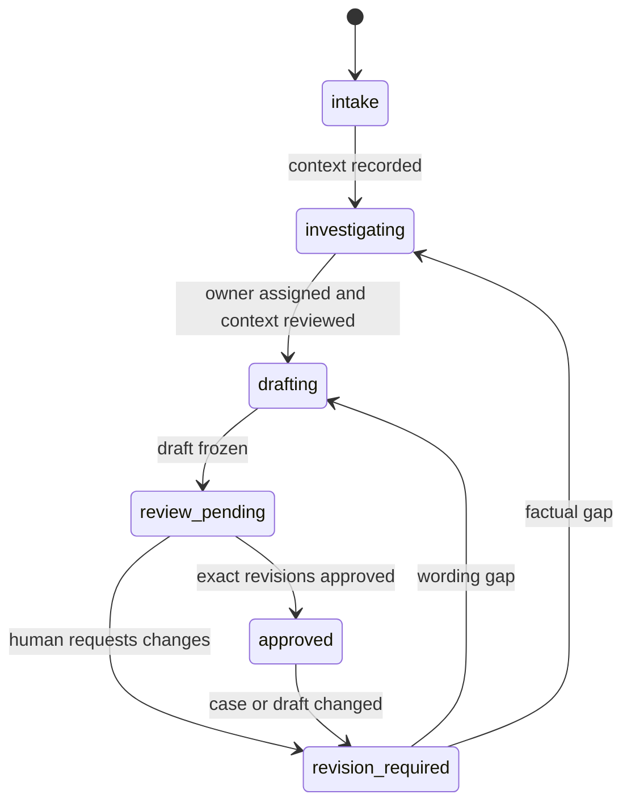

# Module boundaries and state — gotham

The proposed architecture separates case facts, drafting and approval. Implement it as logical components in one application initially; a distributed service topology and model provider are not prerequisites. The workflow can be performed by people using these contracts. Role specifications do not schedule background work or authorize communication.

| Module | Owns and accepts | Produces; prohibited responsibility |
| --- | --- | --- |
| Case intake | Attributed report, channel and prior attempts | Revisioned case context; cannot mark allegations verified. |
| Evidence ledger | Synthetic source references, reviewed status, claim links | Claim classifications and contradictions; cannot infer truth from repetition. |
| Ownership coordinator | Assigned role, proposed commitments, escalation reasons | Confirmed next action or investigation request; cannot promise unowned outcomes. |
| Draft composer | Current context, claim ledger and approved commitments | Revisioned sentences with claim references; cannot approve or send. |
| Review gate | Exact case/draft revisions and reviewer decision | Approval or actionable revision request; cannot silently edit approved content. |
| Audit projection | Safe state transitions and reason codes | Synthetic evidence record; excludes private message text and personal identifiers. |

## State transitions

`approved` means preparation approved, not delivered or resolved. A case may pause in `investigating` with unanswered questions; do not force a reply deadline. An intake error returns a correction request without manufacturing a complete case. There is deliberately no `sent` transition. A future delivery system needs its own authorization, recipient selection, idempotency and observed status contract.

Each case-content change (context, claims, evidence, owner or commitments) increments `case_revision`; draft edits increment both `case_revision` and `draft_revision`. A review decision or workflow-state projection does not change those content revision numbers; it records its own review event. Review stores both approved revisions. The gate must compare those revisions atomically against the current snapshot so a concurrent edit cannot inherit approval. Revision requests invalidate the old approval. Preserve previous review decisions in a future append-only internal history; the public fixture includes only the current snapshot and no real history.

## Contracts and semantic invariants

The [review snapshot schema](../contracts/case-review.schema.json) is stricter than the existing illustrative root example. It is proposed internal state, not a compatible ticket API or an instruction to ingest real complaints. Synthetic IDs make fixtures reviewable; production identity mapping is unresolved. A client may submit only a permitted command such as `recordReport`, `reviewEvidence`, `assignOwner`, `recordCommitment`, `saveDraft` or `reviewDraft`, never overwrite the entire snapshot to self-approve.

Early `intake` and `investigating` snapshots may omit `owner_role` and `draft`; entering drafting or review-related states requires both. The review decision begins as `not_reviewed`.

Schema checks required fields, enum values, verified-claim evidence presence and approval shape. Domain validation must additionally resolve every reference, verify reviewed evidence actually supports the asserted claim, enforce author/reviewer separation and compare approval revisions. A draft claim reference is a traceability pointer, not proof that the wording is faithful. Sentence-level review remains mandatory.

A `confirmed` commitment must point to reviewed evidence of an authorized owner's agreement, not simply a proposed date copied from a report. Use `due_text` to preserve the agreed phrasing in the demo; real implementations need a separately decided calendar/timezone model before automated deadline handling. No numerical service-level target is inferred.

Errors use safe codes such as `CONTEXT_INCOMPLETE`, `REFERENCE_MISSING`, `EVIDENCE_UNREVIEWED`, `COMMITMENT_UNCONFIRMED`, `SELF_REVIEW` and `STALE_REVIEW`. Retrying a review after a revision conflict requires re-reading the current case and draft. Do not reconstruct an approval from a browser cache. External ticket, mail or chat adapters remain outside this design and must never be introduced as an implicit side effect of approval.

[Engineering index](index.en.md)
